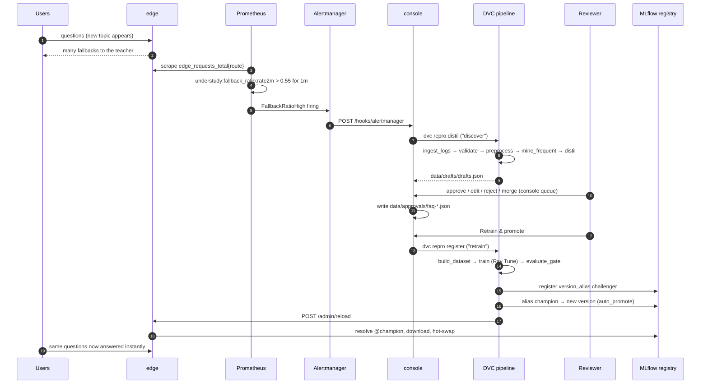

# Architecture

Understudy is a two-tier question-answering system with an automated improvement loop:

* a small **student** model at the edge answers frequent questions instantly from an approved
  answer bank;
* a self-hosted **teacher** LLM on the server answers everything else, streaming;
* a **DVC pipeline** turns questions that have *become* frequent into new approved answers
  and a retrained student, gated and promoted through the **MLflow model registry**;
* **Prometheus / Alertmanager / Grafana** watch both tiers and start the loop when the
  question mix drifts.

Everything runs on one machine (CPU only) under Docker Compose (`docker-compose.yml`).

## 1. Block diagram

```mermaid
flowchart LR
  subgraph Client
    B[Browser<br/>chat + console pages]
  end

  subgraph Proxy["ui: nginx (TLS :8443)"]
    N[static UI<br/>/api/edge/ → edge<br/>/api/console/ → console<br/>/api/edge/admin/* blocked]
  end

  subgraph EdgeTier["Edge tier (1 CPU / 1 GB)"]
    E[edge :8001<br/>Router + StudentPredictor<br/>ONNX 8-bit encoder + head<br/>AnswerBank · MicroBatcher<br/>QueryLogger (PII-scrubbed)]
  end

  subgraph ServerTier["Server tier"]
    G[gateway :8002<br/>input guard · prompt-injection guard<br/>first-token / total timeouts<br/>TTFT, tokens/s metrics]
    T[teacher :8000/teacher<br/>Ray Serve deployment<br/>llama.cpp Qwen2.5-3B Q4_K_M]
  end

  subgraph Ops["Operations"]
    C[console :8003<br/>DAG status · approvals<br/>registry ops · pipeline runner<br/>Alertmanager webhook]
    M[(MLflow :5000<br/>tracking + model registry<br/>aliases champion / challenger)]
  end

  subgraph Pipeline["DVC pipeline (dvc.yaml), run by the console or a developer"]
    direction TB
    P1[ingest_dataset] --> P3[validate]
    P2[ingest_logs] --> P3
    P3 --> P4[preprocess<br/>Spark]
    P4 --> P5[mine_frequent<br/>Spark ML KMeans]
    P5 --> P6[distil<br/>Ray actors + llama.cpp]
    P6 --> H{{human approval<br/>data/approvals/*.json}}
    H --> P8[build_dataset]
    P7[export_encoder<br/>ONNX 8-bit] --> P8
    P8 --> P9[train<br/>Ray Tune]
    P9 --> P10[evaluate_gate]
    P10 --> P11[register]
    P4 --> P12[eda]
  end

  subgraph Mon["Monitoring"]
    PR[Prometheus :9090<br/>scrape + alert rules]
    AM[Alertmanager :9093]
    PG[Pushgateway :9091]
    GF[Grafana :3000<br/>provisioned dashboard]
  end

  B -->|HTTPS| N
  N --> E
  N --> C
  E -->|POST /stream, /grade| G
  G -->|POST /stream, /generate| T
  E -->|resolve models:/…@champion<br/>download artifacts| M
  E -->|querylogs/*.jsonl| P2
  C -->|dvc repro …| Pipeline
  C -->|aliases, rollback| M
  C -->|POST /admin/reload| E
  P9 -->|runs, pyfunc model| M
  P11 -->|register, set aliases| M
  P11 -->|POST /admin/reload| E
  Pipeline -->|stage metrics| PG
  PR -->|scrape /metrics| E & G & T & C & PG
  PR --> AM
  AM -->|webhook /hooks/alertmanager| C
  GF --> PR
```

## 2. The closed loop



Rollback is the same last two steps in reverse: the console (or
`python -m understudy.pipeline.register rollback`) moves the `champion` alias back to the
version recorded in the `previous_champion` tag and calls `POST /admin/reload` on the edge.

## 3. Blocks

| Block | Code | Responsibility |
|---|---|---|
| UI / proxy | `ui/`, `docker/Dockerfile.ui` | Static chat (`index.html`) and console (`console.html`) pages; nginx terminates TLS (self-signed cert created on first start), proxies `/api/edge/` and `/api/console/`, disables buffering for SSE, refuses `/api/edge/admin/*`. |
| Edge | `src/understudy/edge/`, `student/` | Validates a question, scrubs PII, routes it with the student (`Router`, threshold τ). Instant answers come from the answer bank shipped inside the model. Fallbacks are relayed from the gateway as SSE, with a "while you wait" card. Every question is logged by `QueryLogger`. Hot-reloads the champion. Runs under a 1 CPU / 1 GB limit. |
| Gateway | `src/understudy/gateway/` | The only entry to the teacher. Cleans input, blocks prompt-injection patterns, waits for the first token before committing a status code (`503`/`504`), enforces the total timeout, records TTFT and decode speed. Also exposes `/grade` for shadow grading. |
| Teacher | `src/understudy/teacher/` | Ray Serve deployment around llama.cpp (one model per replica, `max_ongoing_requests=1`). Versioned prompts in `configs/prompts/teacher_v1.yaml`. `/stream` for live answers, `/generate` for `answer`/`distil`/`grade` tasks. |
| MLflow | `docker/Dockerfile.mlflow`, `mlflow-data/` | Tracking (runs, params, metrics, plots, nested Tune trials) and the model registry `understudy-student` with aliases `champion` and `challenger`. SQLite backend, artifacts proxied by the server. |
| Console | `src/understudy/console/` | Operations API for the console page: DAG and stage status, approval queue, registry versions/rollback/promote, background `dvc repro` runner, traffic simulation, Alertmanager webhook. Runs in the pipeline image with the repository mounted at `/app`. |
| DVC pipeline | `dvc.yaml`, `src/understudy/data/`, `src/understudy/pipeline/` | Reproducible stages from raw data to a registered student (see `docs/HLD.md` §4). |
| Monitoring | `monitoring/` | Prometheus scrapes every service, evaluates recording/alert rules; Alertmanager routes alerts to the console; Pushgateway receives batch-stage metrics; Grafana shows the provisioned dashboard (`scripts/build_dashboard.py` generates it); each service also exports its own process CPU and resident memory (`process_*`). |

## 4. Loose coupling

Blocks only talk to each other over HTTP using the URLs in `configs/services.yaml`.
Any key can be overridden with an environment variable `UNDERSTUDY_<SECTION>_<KEY>`
(`common/config.py: load_services`). Override values are parsed as YAML scalars, so `"null"` becomes `None`.
Docker Compose uses this to point the blocks at service names:

```yaml
UNDERSTUDY_EDGE_URL: http://edge:8001
UNDERSTUDY_GATEWAY_URL: http://gateway:8002
UNDERSTUDY_TEACHER_URL: http://teacher:8000/teacher
UNDERSTUDY_MLFLOW_TRACKING_URI: http://mlflow:5000
UNDERSTUDY_PROMETHEUS_PUSHGATEWAY_URL: http://pushgateway:9091
```

Consequences:

* The edge never imports teacher code; it only knows the gateway URL. The teacher can be
  replaced by any service implementing `POST /stream` and `POST /generate`.
* The edge resolves its model through the registry URI `models:/understudy-student@champion`
  (or a local directory), so a new model needs no edge redeploy.
* Pipeline stages communicate through files tracked by DVC, not through services. `distil`
  loads its own llama.cpp actors and does not depend on the live teacher.
* With the teacher down, the edge keeps answering frequent questions. With the registry down,
  the edge keeps serving the model it already has.

## 5. Ports and URLs

| Service | Container port | Host URL | Notes |
|---|---|---|---|
| ui (nginx) | 443, 80 | https://localhost:8443, http://localhost:8080 | 8080 redirects to HTTPS |
| edge | 8001 | http://localhost:8001 | `/ask`, `/predict`, `/feedback`, `/info`, `/faqs`, `/admin/reload`, `/metrics` |
| gateway | 8002 | http://localhost:8002 | `/stream`, `/grade`, `/ready`, `/metrics` |
| teacher | 8000 (Ray Serve), 8080 (Ray metrics) | http://localhost:8000/teacher | 8080 only inside the Compose network |
| console | 8003 | http://localhost:8003 | `/api/*`, `/hooks/alertmanager`, `/metrics` |
| mlflow | 5000 | http://localhost:5000 | UI + REST + artifact proxy |
| prometheus | 9090 | http://localhost:9090 | |
| alertmanager | 9093 | http://localhost:9093 | |
| pushgateway | 9091 | http://localhost:9091 | |
| grafana | 3000 | http://localhost:3000 | admin / `GRAFANA_ADMIN_PASSWORD` (default `understudy`); anonymous viewer enabled |

## 6. Volumes and state

| Path / volume | Owner | Content |
|---|---|---|
| `./mlflow-data` | mlflow | `mlflow.db` (SQLite) and `artifacts/` |
| `./data/querylogs` | edge (rw) | `edge-YYYYMMDD.jsonl`, `feedback-edge-YYYYMMDD.jsonl`, offline `sim-week-XX.jsonl` |
| `./models/gguf` | teacher (ro) | pinned GGUF weights |
| `./` (whole repo) | console (rw) | DVC workspace: data, models, reports, approvals, `dvc.lock` |
| `edge-cache` | edge | downloaded registry versions (`v<N>/artifacts/student`) |
| `hf-cache` | console | Hugging Face cache (MiniLM for mining) |
| `prometheus-data`, `grafana-data`, `ui-certs` | monitoring / ui | TSDB, Grafana state, TLS certificate |
