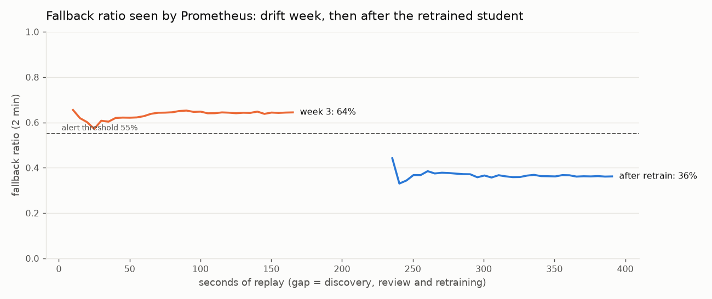

# Test report

Generated 2026-11-05 22:31 UTC by `scripts/test_report.py` from the artifacts in `reports/`. Plan and criteria: [test_plan.md](test_plan.md).

## Test runs

| Level | Passed | Failed | Errors | Skipped | Total | Time (s) |
|---|---|---|---|---|---|---|
| unit | 112 | 0 | 0 | 0 | 112 | 6.7 |
| integration | 6 | 0 | 0 | 0 | 6 | 138.9 |
| e2e | 7 | 0 | 0 | 0 | 7 | 7.2 |
| load (Locust) | 3471 | 0 | – | – | 3471 | – |

## Acceptance criteria

| # | Criterion | Target | Measured | Result |
|---|---|---|---|---|
| A1 | Instant-answer p95 on the 1 CPU / 1 GB edge | < 100 ms | 11.18 ms sequential; 69.01 ms with 8 concurrent clients | **PASS** |
| A2 | Fallback: time to the 'while you wait' card | < 1 s | max 14.7 ms; first token p50 576.5 ms | **PASS** |
| A2b | Teacher time to first token (reported) | reported | p50 0.539 s, p95 0.758 s; 14.07 tok/s | reported |
| A3 | Instant-answer precision, held-out queries (traffic mix) | ≥ 95% | 99.1% (uniform-mix stress test: 85.6%) | **PASS** |
| A4 | Out-of-scope questions answered by the student | ≤ 5% | 0.5% | **PASS** |
| A5 | Coverage recovers after retraining | recovers | fallback ratio 63.9% in drift week → 36.2% after retraining (student v1 → v2) | **PASS** |
| A6 | New topic → drift alert | within one simulated week | alert firing 70 s into the drift week's 166.7 s replay | **PASS** |
| A7 | Rollback to previous student under load | < 1 min, no downtime | 1.99 s (alias move + edge hot reload); 0 failed of 6228 requests; versions served {'2': 4235, '1': 1993} | **PASS** |
| A8 | API error rate under load | < 5% | 0.0% of 3471 requests; median 15 ms, p95 33 ms | **PASS** |
| A9 | Rebuild the student from a fresh clone | one command: `dvc repro` | pinned dataset/model SHA-256 + dvc.lock; CI runs `dvc repro` | see CI log |

## Current student (last training run)

| Metric | Value |
|---|---|
| `n_faqs` | 36 |
| `tau` | 0.9 |
| `val_instant_precision` | 0.9725 |
| `val_coverage` | 0.7584 |
| `test_traffic_precision` | 0.9907 |
| `test_traffic_coverage` | 0.7409 |
| `test_instant_precision` | 0.8488 |
| `test_oos_false_accept` | 0.004 |
| `test_uncovered_false_accept` | 0.034 |
| `latency_p95_ms` | 7.77 |
| `model_size_mb` | 22.65 |
| `tune_trials` | 32 |
| `tune_feasible_trials` | 22 |

## Drift demo timeline

| Time (UTC) | Event | Details |
|---|---|---|
| 21:45:18 | start | champion=1 |
| 21:45:28 | alert pending | alert=FallbackRatioHigh, week=3, fallback_ratio=0.6551724137931034 |
| 21:46:28 | alert firing | alert=FallbackRatioHigh, week=3, fallback_ratio=0.6426735218508998 |
| 21:48:09 | drift week replayed | week=3, fallback_ratio=0.639, routes={'student': 722, 'teacher': 1278} |
| 21:48:09 | discovery started by alert | reason=alert: FallbackRatioHigh at 2026-11-05T21:46:36.405094+00:00 |
| 21:57:34 | discovery finished | state=succeeded, duration_s=654.0 |
| 21:57:34 | simulated reviewer decided drafts | approved=15, rejected=9, merged=15 |
| 21:57:34 | retrain started |  |
| 22:00:40 | retrain finished | state=succeeded, duration_s=182.7, gate=True, registered=2, edge_reloaded=True |
| 22:03:30 | post-retrain week replayed | week=4, fallback_ratio=0.362, routes={'student': 1276, 'teacher': 724} |

