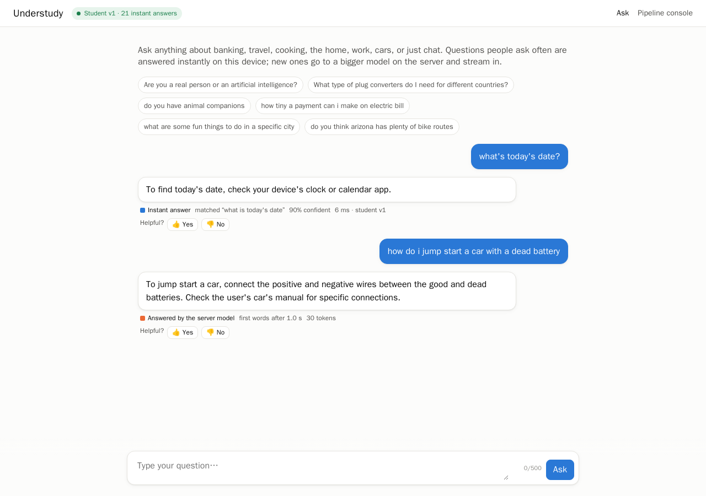
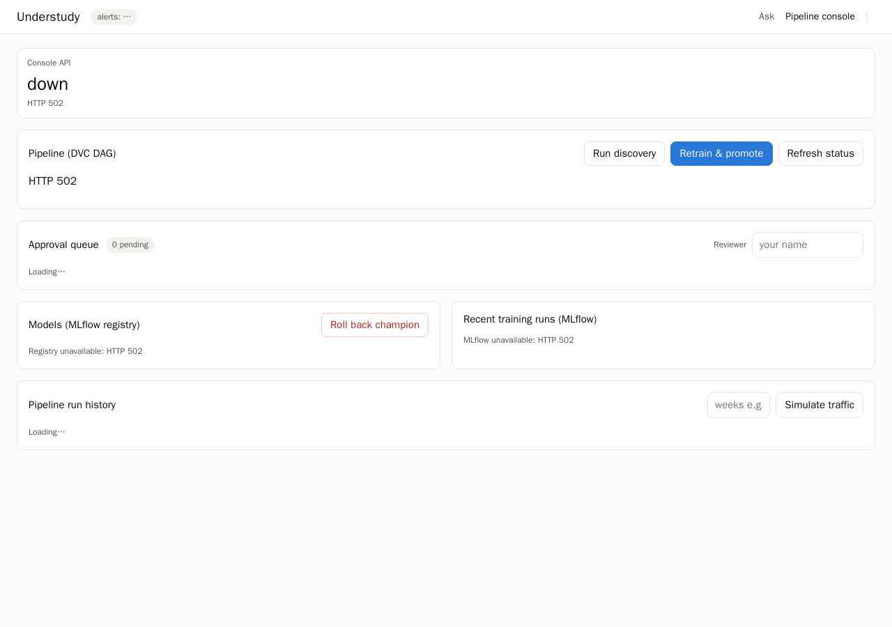
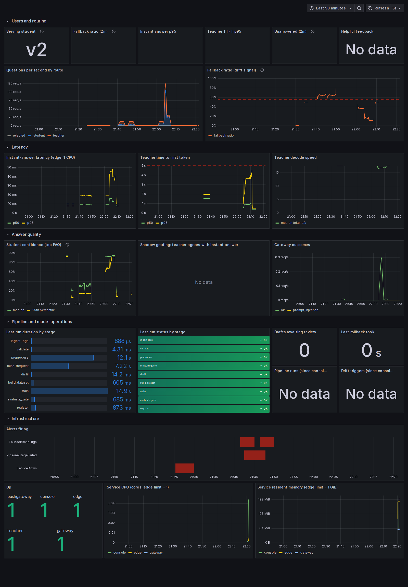

# User manual

There are two audiences:

* **People asking questions**: see §3 (the chat page).
* **Operators**: they run the system, review drafts and manage models. See §1–2 and §4–7.

## 1. Starting the system

### Prerequisites

* Linux with Docker Engine and Docker Compose v2. Your user must be in the `docker` group.
* Miniforge or conda (for the pipeline and the command-line tools).
* About 10 GB of free disk space and 16 GB of RAM. No GPU is needed.

### One-time setup

```bash
git clone https://github.com/samrudh123/Understudy && cd Understudy
conda env create -f environment.yml && conda activate understudy
pip install -e . --no-deps
make hooks                                   # lint + unit tests before each commit
python -m understudy.teacher.download        # pinned 2.1 GB teacher weights (SHA-256 checked)
```

### First model (cold start)

The edge needs a registered *champion* before it can answer anything instantly. Create one
from two weeks of simulated history:

```bash
docker compose up -d mlflow                  # or: make mlflow  (use only one of the two; both use :5000)
dvc repro ingest_dataset
python -m understudy.data.simulate_traffic --weeks 0-1      # offline: writes data/querylogs/sim-week-0X.jsonl
dvc repro distil                             # mine frequent questions, teacher drafts FAQs (~10 min on CPU)
python -m understudy.pipeline.approve list   # review drafts (or use the console, §4)
python -m understudy.pipeline.approve auto   # OR let the simulated reviewer decide (demo only)
dvc repro                                    # dataset → train → gate → register → champion v1
```

### Run everything

```bash
docker compose up -d --build                 # all services
TEACHER_FAKE=1 docker compose up -d          # no 2 GB model: canned teacher answers (smoke tests)
docker compose ps                            # all services should be "Up" / "healthy"
```

The teacher needs about a minute to load the model. The first teacher answer is slower
(about 4 s to the first words); later answers start in about 0.5 s.

### Addresses

| What | URL | Login |
|---|---|---|
| Chat | https://localhost:8443/ | none |
| Pipeline console | https://localhost:8443/console.html | none |
| Grafana dashboard | http://localhost:3000 | anonymous view; admin / `understudy` (`GRAFANA_ADMIN_PASSWORD`) |
| MLflow | http://localhost:5000 | none |
| Prometheus | http://localhost:9090 | none |
| Alertmanager | http://localhost:9093 | none |

The certificate is self-signed, so the browser warns once. Accept it, or mount your own
certificate into the `ui-certs` volume (`/etc/nginx/certs/understudy.{crt,key}`).
http://localhost:8080 redirects to HTTPS.

To protect the edge's reload endpoint, set `UNDERSTUDY_ADMIN_TOKEN=<secret>` in the
environment, or in a `.env` file next to `docker-compose.yml`, before `docker compose up`.

## 2. What the system does

Questions that many people ask have **approved answers**, and the small model on the edge
returns them instantly. Every other question goes to a larger model on the server, which
streams its answer.

All questions are logged without personal data. When a new kind of question becomes
common, the pipeline drafts an FAQ entry, a person approves it, and the small model is
retrained. From then on that question is answered instantly too.

## 3. Using the chat

1. Type a question (up to 500 characters) and press **Enter** or **Ask**.
   **Shift+Enter** inserts a new line. The counter turns red above the limit.
   The buttons under the introduction are popular questions. Click one to ask it.
2. **Instant answer**: the answer appears at once, with a blue badge. The badge shows:
   * the approved question it matched,
   * how confident the model is,
   * the response time,
   * the model version (for example `student v2`).
3. **Server answer**: a grey "while you wait" card appears first. It may also suggest
   approved questions that look related; click one to get that answer instantly.
   The answer then appears word by word, with an orange badge showing when the first
   words arrived.
4. Rate any answer with **👍 Yes** or **👎 No**. Ratings feed the "Helpful feedback" figure
   in Grafana.

Messages you may see:

| Message | Meaning |
|---|---|
| "The answer service is busy or offline right now…" | The server model is down or too slow. Instant answers still work; try again in a minute. |
| "I can only help with questions. Please rephrase…" | The message looked like an attempt to change the assistant's instructions. |
| Red banner "Can't reach the assistant" | The edge service is not reachable. |
| Amber pill "No student yet" | No model has been approved yet; every answer comes from the server. |

## 4. Using the pipeline console

**Top tiles** show:
* the serving model version, its number of FAQs and its threshold τ;
* the fallback ratio over the last 10 minutes;
* pending approvals;
* the last gate decision, with its precision and coverage;
* the last pipeline run.

The pill in the header shows the alerts currently firing. Links to MLflow, Grafana,
Prometheus and Alertmanager are on the right.

**Pipeline (DVC DAG)** shows every stage. The left border colour gives its state: green
means the last run succeeded, red means it failed, and amber means it is out of date because
inputs changed. Each node shows the duration and rows of the last run; hover over a node for
its command and last run time.

* **Run discovery**: `dvc repro distil`. Snapshots the logs, preprocesses them, mines
  frequent fallbacks and has the teacher draft FAQ entries. Drift alerts start this
  automatically.
* **Retrain & promote**: `dvc repro register`. Builds the dataset from approvals, tunes and
  trains, gates, registers and, if the gate passes, promotes and reloads the edge.
* While a run is active, its live log is shown and the buttons are disabled. Only one run
  can happen at a time.

**Approval queue**: enter your name as *Reviewer* first; it is remembered in this browser.
Each draft shows:
* how many user questions it covers and their share of all fallbacks,
* the teacher model and prompt version,
* editable fields for the question, the answer and the paraphrases (one per line),
* the real user questions behind it (expand to see them).

| Button | Effect |
|---|---|
| Approve | Saves the (edited) entry as a new FAQ. **Check the answer**: the teacher can be wrong. |
| Reject | The cluster is never drafted again. Use for out-of-scope, unclear or mixed topics. |
| Merge into ▾ | The draft duplicates an existing FAQ. Its questions become extra training phrasings for that FAQ. |

After reviewing, click **Retrain & promote**.

**Models (MLflow registry)** lists each version with its aliases and gate metrics.
* **Promote** makes that version the champion and reloads the edge.
* **Roll back champion** returns to the version the current champion replaced. The toast
  shows how long it took (usually 1–2 s) and whether the edge reloaded.

**Recent training runs** links each run to its MLflow page. Failed runs are highlighted.

**Pipeline run history** lists previous console runs. **Simulate traffic** replays simulated
weeks (for example `3` or `2-3`) against the edge, for demonstrations.

## 5. Reading the Grafana dashboard

Open http://localhost:3000. The dashboard "Understudy: edge, teacher and pipeline" is the
home page.

| Row | What to look at |
|---|---|
| Users and routing | Questions per second by route (blue: instant, orange: teacher, red: unanswered). The **fallback ratio** line has its alert threshold dashed at 55 %. |
| Latency | Instant-answer p50/p95 (target < 100 ms); teacher time to first token; decode speed. |
| Answer quality | The confidence distribution: a shift towards low confidence is an early drift sign. Shadow-grading agreement; gateway outcomes. |
| Pipeline and model operations | Last duration and status of every stage (pushed by the pipeline), drafts awaiting review, last rollback time, runs and drift triggers in 24 h. |
| Infrastructure | Which services are up; CPU and memory per container (the edge should stay under 1 CPU / 1 GB). |

Red vertical markers are firing alerts.

## 6. Alerts and what to do

| Alert | Meaning | Action |
|---|---|---|
| FallbackRatioHigh | More than 55 % of questions need the teacher: a new topic is trending. | Nothing at first: discovery starts automatically. Then review the new drafts and click **Retrain & promote**. |
| EdgeErrorRateHigh | More than 5 % of questions could not be answered. | Check `docker compose ps` and the gateway/teacher logs. Restart the teacher if needed. |
| TeacherTTFTHigh | The server model takes over 5 s to start answering. | Increase `TEACHER_REPLICAS` / `TEACHER_THREADS`, or reduce other CPU load. |
| EdgeLatencyHigh | Instant answers p95 above 100 ms. | Check edge CPU in Grafana; reduce concurrent load. |
| StudentPrecisionLow | The teacher judges over 10 % of sampled instant answers as irrelevant. | Roll back the champion, then check recent approvals. |
| PipelineStageFailed | A pipeline stage failed on its last run. | Open the console DAG (red node) and the run log; see `reports/stages/<stage>.json`. |
| EdgeNoModel | The edge has no model. | Make sure a champion exists (`register status`) and MLflow is up. |
| ServiceDown | A service stopped responding. | `docker compose up -d <service>`; see its logs. |

## 7. Command-line equivalents

```bash
# review
python -m understudy.pipeline.approve list
python -m understudy.pipeline.approve approve cand-1234abcd --reviewer alice
python -m understudy.pipeline.approve reject  cand-1234abcd --reviewer alice
python -m understudy.pipeline.approve merge   cand-1234abcd --into faq-abcd1234 --reviewer alice
python -m understudy.pipeline.approve auto --reviewer sim-reviewer     # simulation ground truth; demos only

# registry
python -m understudy.pipeline.register status
python -m understudy.pipeline.register rollback [--to 3]
python -m understudy.pipeline.register promote 4

# traffic
python -m understudy.data.simulate_traffic --mode offline --weeks 0-1
python -m understudy.data.simulate_traffic --mode online --weeks 3 --qps 12 --teacher-rate 0.01

# pipeline and checks
dvc repro distil        # discovery        dvc repro register   # retrain + promote
dvc dag                 # the graph        dvc status           # what is out of date
make lint | make test | make test-unit | make test-integration | make ci | make mlflow
python scripts/bench_teacher.py --n 20          # teacher latency baseline
python scripts/bench_edge.py --n 300 --concurrency 8
python scripts/drift_demo.py --drift-week 3 --after-week 4
```

## 8. Troubleshooting

| Symptom | Cause | Fix |
|---|---|---|
| Chat pill "No student yet"; edge `/ready` returns 503 | No champion in the registry, or MLflow unreachable from the edge. The edge retries every 10 s. | Follow §1 "First model"; check `docker compose ps mlflow`. |
| First teacher answer takes several seconds | Model load and first prompt pre-fill. | Expected; later answers start in about 0.5 s. |
| "MLflow is not reachable at …" from `dvc repro` or the console | MLflow is not running, or the wrong URL is set. | `docker compose up -d mlflow` (or `make mlflow`). Set `MLFLOW_TRACKING_URI` if it is elsewhere. |
| `address already in use` on start | Another process uses a port (for example a host `mlflow server` on 5000). | Stop it, or change the host port in `docker-compose.yml`. |
| Browser certificate warning | Self-signed certificate. | Accept it for `localhost`, or provide your own certificate (§1). |
| Retrain finished but the champion did not change | The gate failed. | See the console "Last gate" tile or `reports/gate.json` → `reasons`. |
| Rollback says "no previous_champion" | The champion was never promoted over an older version. | Use **Promote** on a specific version instead. |
| Console run fails immediately | Another run holds the DVC lock, or the stage crashed. | Read the run log in the console; `reports/stages/<stage>.json` shows the failing stage. |
| `validate` stops the pipeline | More than 1 % of log lines are malformed, or the dataset checks failed. | See `reports/validation.json`; fix or remove the bad log file. |

## Screenshots

Chat: an instant answer with its badge, and a fallback streamed from the teacher.



Pipeline console: live DVC DAG, approval queue, registry, training runs.



Grafana: routing, drift signal, latency, answer quality, pipeline and alert timeline.


